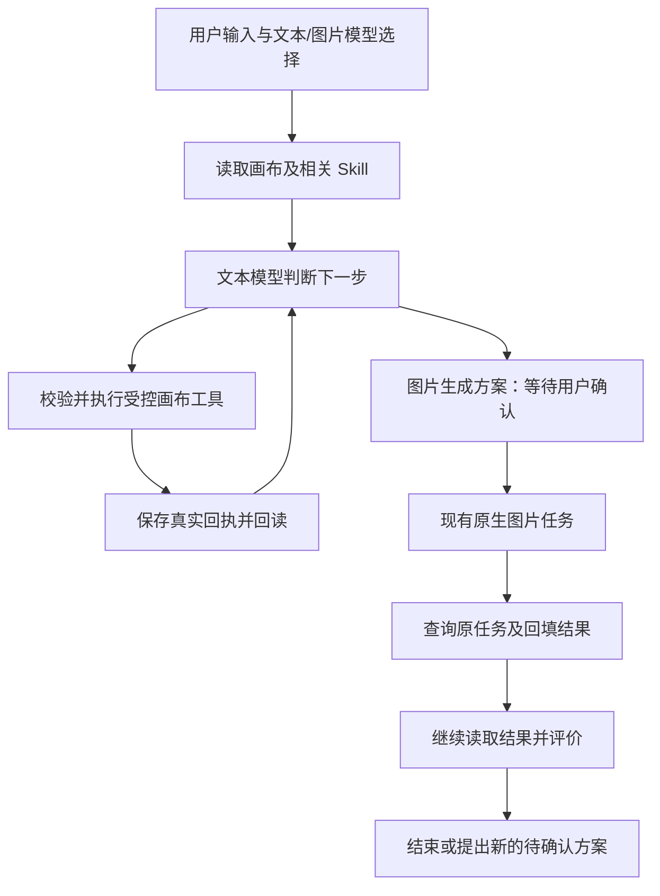

# 创作助手 Agent 与内置 Skill 接入设计

日期：2026-10-08；更新：2026-10-09。状态：设计已本地实施，隔离验收完成，等待用户最终功能确认；真实供应商效果未验证。

## 1. 目标和成功标准

把现有普通画布、智能画布的创作助手升级为能读画布、制定方案、实际操作、回读结果并继续判断的创作 Agent。沿用现有助手入口和画布元素，不复制 Nomi 外观。

首阶段完成一个完整场景：用户引用素材，要求制作海报；助手结合画布与选中素材制定方案，创建或修改原生节点，提出图片方案；用户点击现有“生成”按钮后执行原生任务，完成后助手读取真实结果，给出评价或改进方案。再次生成仍须重新确认。

用户已明确的约束：

- 文本模型与图片模型分别手动勾选。助手智能判断图片需求，不增加“图片生成模式”。
- GPT CLI 图片保留现有官方登录账号的调用方式，不因 Agent 引入而改读文本中转配置。
- 模板库、模型、Skill 在输入框下方按顺序排布；用现有图标、主题、字体与弹出面板规范。
- 背景是真正透明，不使用模糊；文字与关键按钮清晰。保留已有输入高度和悬浮布局。
- 不开发助手整轮撤销，用户使用现有画布手动操作。
- 实际生成继续由用户确认。设计、开发与模拟验收不调用收费模型。

首阶段包括多步执行、受控工具、过程显示、停止、断点恢复与三项内置 Skill。视频生成、批量付费任务、角色库、复杂分镜阶段机、跨画布记忆和自动积累 Skill 分开排期，不混进本次交付。

## 2. 已确认的项目基础

当前功能基线为 `b01347fd821a3b57757931208d432706dcd459c2`。双模型与图片生成确认闭环已验收同步；透明背景等工作区改动仍独立保留。

- `backend/canvas_assistant.py` 目前每轮调用一次模型，解析操作，再保存结果；没有执行后继续请求模型的循环。
- `backend/canvas_assistant_operations.py` 已校验节点创建、正文修改、连接与图片提议，已有版本校验和保存回执。
- `backend/canvas_assistant_generation.py` 已绑定生成快照和校验确认请求。
- `main.py` 通过 `call_canvas_assistant_model` 接入 `canvas_llm`；现有接口主要返回正文，不能直接当作原生工具调用接口。
- 图片任务由 `/api/canvas-image-tasks` 持久化、查询与回填；Agent 不另建图片任务队列。
- `static/js/canvas-assistant.js` 共用助手界面，两种画布分别提供原生适配。

以上为设计开始时的源码基线。新 Agent、Skill 和结果续行的当前实现与验证状态见第 11 节；真实供应商模型的可靠性尚未实测。

## 3. 参考项目与功能对照

Nomi 研究版本固定为 `d59bbc785d51542ab187df67a8c8c2e9fd22841c`。现役入口是 `electron/agentLane`，底层依赖 Pi 0.85.1；不以旧 harness 目录或历史路线说明作为当前功能证据。

| 功能与真实入口 | 参考项目行为 | 本项目接入决定 |
| --- | --- | --- |
| `laneHost.mts` | 模型请求、工具执行、工具回执继续驱动后续请求，顺序执行；模型选择恢复后重新绑定 | 在现有 Python 请求入口加入受限执行循环；每次调用固定用户本轮文本模型 |
| `laneToolCatalog.ts`、`laneRuntimePort.ts` | 统一工具说明、参数、效果与执行回执；控制常驻工具数量 | 一份画布工具注册表同时供模型、校验与过程显示使用；首版仅六个工具 |
| `laneApprovalGate.ts` | 审批绑定具体工具调用，停止与重启处理待审批状态 | 复用现有图片提议卡和快照；点击“生成”确认一项具体方案，不新增权限档位 |
| `laneModelProvider.mts` | 支持 OpenAI 兼容、Responses、Anthropic 协议，自定义平台模型 | 沿用本项目 API 设置、CLI 与模型列表；不能假设 Pi 或 Nomi 自动支持本项目 CLI 登录 |
| `laneSkillCatalog.mts` | 每个用户回合刷新 Skill 索引，正文按需加载 | 每轮固定索引快照；手选 Skill 注入，自动模式仅加载相关内置 Skill |
| `laneSkillPrompt.mts` | 选中 Skill 的正文与使用引导进入模型上下文 | 接入真实请求，记录本轮使用 Skill 的编号与版本；仅显示勾选不算完成 |
| `docs/skill-pack-format.md` | 目录与 `SKILL.md`，支持 references/assets；旧 stages 字段不是执行引擎 | 用目录、正文与引用文件；首版不运行 Skill 脚本、不提供第三方导入 |
| `laneDesktopTasks.ts` | 任务状态作为真实事实供助手读取 | 查询现有图片任务，不用模型回复推断完成 |
| `productionRun/productionPlaybooks.ts` | 长制作流程使用独立阶段机 | 后续复杂分镜和视频阶段单独设计；不把 Skill 文案当可执行阶段机 |
| 会话与恢复 | 工具调用/结果持久化；恢复未完成动作不盲目重放 | 扩展现有助手历史，按操作回执与原任务编号恢复 |
| 历史经验沉淀 | 部分旧路径已退役，不能据旧说明宣称已自动学习 | 本期不宣称自动学习、自动生成或更新 Skill |

参考按钮与状态映射：Nomi 的发送、停止、模型、Skill、任务与审批逻辑分别映射到本项目已有发送、停止、模型、新增 Skill、现有任务卡与“生成/先不用”。本项目保留新对话、历史、模板库、复制、创建提示词节点、查看画布及引用素材功能，不用参考项目的界面替换它们。

参数归属：文本平台/模型用于规划请求；图片平台/模型、比例、分辨率、质量与参考图用于最终生成请求。背景透明度、面板位置与高度只影响显示。Skill 改变创作方法与提示词，不替用户更换图片模型。原生参数范围、默认值与可用限制以本项目现有 API 设置和节点实现为准。

本轮核对了参考源码与界面文档，未启动 Nomi 实机验证其所有按钮，未宣称其全功能已验收。实际实施时以本项目两种画布的点击结果验收上述映射。

## 4. 三种接入方式与推荐

| 方案 | 优点 | 本项目需要承担的接入工作 | 决定 |
| --- | --- | --- | --- |
| 现有 Python 后端增加有限 Agent 循环 | 直接复用模型、锁、回执、历史、任务；无需新增运行时 | 独立实现工具调度、回读、限额、停止与恢复，并专项验证 | 推荐首阶段使用 |
| Pi 0.85.1 轻量核心 | 官方已有工具循环、事件、停止、上下文扩展接口，MIT | Node 子进程生命周期、Python 桥、模型协议与历史归属；本机 Node 24.19 满足其 >=22.19 要求，但干净安装仍需验证 | 保留为后续替换执行层的候选 |
| DeepSeek Harness | 插件式模型/工具/会话，Python SDK 提供运行时桥，MIT | 自定义 profile、画布插件、独立 dsh_home 与现有模型适配；Python SDK/运行时要求 >=3.10，本机满足，但安装兼容未实测 | 本期不与另一套执行器叠加 |

推荐依据是当前产品已有大半业务闭环，最缺少的是回读与续行。为补六个画布工具先引入跨进程框架，会增加部署与故障点。此选择是本项目适配建议，不是声称 Python 自建循环等同于 Pi 或 DeepSeek 的全部能力。

只采用 Nomi 的分层思路与行为经验，独立编写适配，不复制其 AGPL-3.0 源码或内置提示词。本项目当前许可证含非商业限制；若以后实际引入第三方代码，应另行核对具体许可与保留署名。Pi、DeepSeek 的许可不等于 Nomi 宿主的许可。

## 5. 执行流程与工具边界

首版工具：

| 工具 | 输入与结果 | 写入边界 |
| --- | --- | --- |
| `read_canvas` | 当前画布、选中节点或已授权引用；返回限制长度的节点、连线与版本 | 只读，不接受任意画布路径 |
| `apply_canvas_operations` | 现有 create/update/connect 操作；返回原生编号、版本与保存回执 | 原有字段校验、画布锁、整批校验和幂等保存 |
| `propose_image` | 提示词、标题与用户已确认的图片设置；返回方案编号和原生节点 | 只创建方案与节点，不提交模型生成 |
| `read_image_task` | 当前用户画布内已绑定的方案/任务编号；返回真实状态 | 只查询，禁止任意任务编号与新建任务 |
| `inspect_result` | 当前画布白名单图片素材编号；向本轮文本模型提供图片 | 不支持视觉的文本模型明确提示限制，不虚构画面评价 |
| `read_skill` | 本轮索引中的内置 Skill 编号或受限引用文件 | 只读指定目录；拒绝路径越界、脚本执行和任意 URL |

`inspect_result` 负责解析与提供真实图片；评价由下一次文本模型调用完成，避免工具内部隐藏另一套模型调度。画布、引用与 Skill 中的文字均作为数据，不能扩大工具权限。

工具默认顺序执行。同一模型响应可包含一个受校验的操作批次；下一次请求必须带该批次真实执行结果。模型建议不等于已执行，成功状态只能来自保存回执或原生任务状态。

## 6. 模型兼容与有限循环

首版保留当前统一模型入口，采用明确的结构化决策协议：回复文本、下一步工具与参数、或结束。后端将 schema 和上一工具结果交给文本模型，严格解析，实际执行后再请求。所有现有 CLI/API 平台仍走自己的现有适配，不把普通正文伪装成上游原生 `tool_calls`。

无效 JSON、未知工具或越界参数不执行；返回有限校验信息允许模型纠正一次。普通聊天无工具时一次调用结束。每轮最多 6 次文本模型请求、8 次工具执行；相同工具与参数连续失败 2 次停止；单次模型超时沿用平台现有超时，整轮累计主动执行最长 15 分钟，不计等待用户确认与供应商生成的时间。请求次数、工具次数与主动执行时间保存到回合，生成后续行或刷新恢复不清零。限额由服务端固定，Skill 与模型不能提高。

这些是首版默认值，不是 Nomi 默认值。额外文本请求可能消耗所选平台额度；用户点击发送启动该受限创作回合。图片仍独立确认，不因“继续”“评价”自动再生成。

出现图片提议后，保存下一步所需状态并结束当前 HTTP 执行等待，显示“等待生成确认”。用户确认后，后端为这个活动回合登记可取消的结果观察，通过注入的原生任务查询接口读取状态；只在仍有活动页面、未停止且预算剩余时触发一次可去重的续行，读取结果再评价。前端报告“完成”不能代替后端查询。观察不拥有生成队列，失败或 30 分钟仍未完成时结束观察，保留原任务供手动查询和继续。

刷新、页面断开或服务重启后不自动新增模型请求，显示“继续创作”供用户恢复；查询与原生回填可以恢复原任务。恢复执行继续使用本轮固定文本模型、剩余预算与有效的 Skill 快照；若所选平台已停用则提示重新发起，不能静默改用另一模型。

## 7. 历史、停止和恢复

- 历史唯一归属仍为 `AssistantStore`，扩展回合中的步骤、工具调用、结果、使用的 Skill 和续行标记，不另建独立 Agent 会话库。
- 每步有稳定 `stepId/toolCallId`；画布写入使用现有回执，任务使用预存编号；结果续行使用任务编号和已消费标记去重。
- 写入回执与历史之间若中断，先查画布回执恢复，不再次执行；任务受理状态不明时查原编号，不盲目重试。
- 停止取消当前本地模型等待，阻止后续工具与自动续行；正在完成的原子保存需收尾。已受理的图片任务仍可完成、回填，停止不能保证取消供应商处理或计费。
- 等待确认时停止后，旧方案卡仍可查看和查询；再次生成或续行需明确操作。模型选择或素材发生变化，沿用当前快照重新校验。
- 手动编辑造成版本冲突时重新读取画布，展示冲突，不覆盖用户修改。所有新工具每次执行都重新校验归属与版本。
- 服务重启将正在执行回合标成中断；不会自动重放未确认动作。旧历史保持可读，旧已完成回合不会升级成待执行任务。

## 8. 内置 Skill 与界面

先独立编写三项内置 Skill：海报构图、参考图改图、提示词优化。目录采用 `skills/canvas-assistant/<id>/SKILL.md`，正文带名称/描述，必要时附 `references/`；不依赖第二份 skill.json。

模型后增加“Skill”图标，弹出本项目原生样式的列表：自动、海报构图、参考图改图、提示词优化。不选具体项时默认自动；手选首版只选一项，避免多套创作规则冲突。自动模式先给模型轻量索引，由模型按需求读取；不加载全部长正文。

选择按现有助手偏好保存到当前用户、当前画布；会话历史记录本轮实际 Skill 及版本摘要。开始一轮后固定 Skill 与模型快照，下一轮再读取最新选择。内置 Skill 不携带平台密钥、供应商默认模型或自动付款权限。

助手展示简短阶段与可展开步骤：读取画布、规划、操作节点、等待确认、生成中、读取结果、完成/失败/停止。保留原图片卡的完整提示词、参考图、生成、先不用、查询原任务、失败重试和查看画布。

布局沿用模板库与模型的紧凑间距，Skill 紧随其后，发送按钮靠右；窄屏允许工具行换行，不能压缩文本框或横向溢出。不修改画布设计系统。透明区域只调整背景 alpha，不使用全容器 opacity 或 backdrop blur。

## 9. 文件与替换范围

预计新增 `backend/canvas_assistant_agent.py`（有限循环与续行）、`backend/canvas_assistant_tools.py`（注册表）、`backend/canvas_assistant_skills.py`（受限索引/加载）及内置 Skill 文件。

修改现有 `backend/canvas_assistant.py` 接入真实 chat/停止/历史/方案事件；`main.py` 注入原生模型、画布、任务及媒体依赖，新模块不反向导入 main。共用助手脚本和作用域样式增加 Skill、步骤与继续入口；画布适配只做必要的公共协议变化。

新循环验证可用后移除被替代的“一次模型调用后结束”调度与旧专用提示协议。节点校验、回执、图片确认、任务适配继续复用，保留旧历史读取。不存在 new/v2 脱离入口副本。当前透明背景等未确认改动独立处理，不混入同步。

## 10. 验收与交付

1. 隔离模拟模型按“读取→操作→回读→提议→确认→任务结果→评价”返回，检查实际多次请求看到真实工具结果；不能只检测提示词字符串。
2. 覆盖普通聊天一次结束、错误自纠、上限、重复失败停止、未知工具、素材/Skill 越界、画布版本冲突、重复确认与重复结果续行。
3. 覆盖写入后历史保存中断、停止竞态、生成等待、刷新/重启、旧历史读取；检查原任务编号和回执防止重复写入、重复生成。
4. 在 Codex 内真实点击两种画布：Skill 选择、发送、步骤展开、生成确认、结果读取、停止、继续、失败重试、保存重开。使用隔离数据和模拟供应商，保存真实截图。
5. 检查浅色、深色、390px 窄屏、中文、禁用、加载、错误、透明背景、节点可见性、模板库与模型距离，以及输入/画布快捷键和重复初始化。
6. 运行相关 Python/JavaScript 测试、语法检查与差异检查；公共任务或存储改动扩大相应回归范围。

交付时明确模拟流程已验范围、真实模型效果未验范围，以及多次文本请求的额度影响。用户手动确认功能成功后，只提交本功能源码、测试、说明并正常上传个人 GitHub；不上传用户数据、凭据、截图或其他未确认改动。

## 11. 调研来源

- [Nomi 现役 Agent](https://github.com/aqm857886159/Nomi/blob/d59bbc785d51542ab187df67a8c8c2e9fd22841c/electron/agentLane/laneHost.mts)
- [Nomi 模型适配](https://github.com/aqm857886159/Nomi/blob/d59bbc785d51542ab187df67a8c8c2e9fd22841c/electron/agentLane/laneModelProvider.mts)
- [Nomi Skill 格式](https://github.com/aqm857886159/Nomi/blob/d59bbc785d51542ab187df67a8c8c2e9fd22841c/docs/skill-pack-format.md)
- [Pi 0.85.1 官方核心接口](https://github.com/earendil-works/pi/blob/v0.85.1/packages/agent/README.md)
- [Pi 0.85.1 依赖、许可与环境要求](https://github.com/earendil-works/pi/blob/v0.85.1/packages/agent/package.json)
- [DeepSeek Harness 架构](https://github.com/deepseek-ai/deepseek-harness/blob/master/docs/architecture.md)
- [DeepSeek Python SDK](https://github.com/deepseek-ai/deepseek-harness/blob/master/python/sdk/README.zh.md)
- [DeepSeek Python 版本门槛](https://github.com/deepseek-ai/deepseek-harness/blob/master/python/sdk/pyproject.toml)

DeepSeek 来源为本轮读取的 master，未安装运行；实际引入时必须锁定具体发布版本，不能将本轮源码读取等同于安装可用验证。

## 11. 当前实现核对（2026-10-09）

设计已按本地实现落地：后端有限多步 Agent 使用现有 Python/FastAPI 入口，Skill 仅从项目白名单目录读取，工具执行复用原生画布和图片任务数据流；前端普通/智能画布共用步骤展示和 Skill 弹层，但保留各自画布的布局与样式。图片任务在用户确认后提交，完成后通过原任务编号查询并将白名单本地图片交给下一次文本模型评价。

交接恢复后重新核对正式服务：status 为 agent，3 项 Skill、文本/图片模型列表正常。隔离模拟服务已在普通和智能画布分别完成一次长任务手动停止，再各完成一次端到端创作；模型读取原生工具回执，用户确认后才提交图片任务，完成后从原任务读取实际图片并续行。刷新后模型和 Skill 勾选、历史及结果保留，模型请求和图片提交次数未增加；390px Skill 弹层无越出屏幕。

审查修复后核心检查通过 Python 563 项、JavaScript 249 项；Agent 23 项、引用 8 项，助手相关五模块合计 75 项通过。最终隔离统计为 2 次图片提交、2 次回读、4 次取消模型等待、0 次生成失败；证据保存于 `output/assistant-image-verification/recovery-verification.json` 的 finalStats 和同目录 `recovery-fixed-*.png`、`recovery-refresh-completed.png`。

后续工具请求及图片续行保留本轮原始要求和历史；续行重新加载素材库引用，并拒绝同编号图片被替换。历史读取不改变活跃执行器的控制权，每次恢复分配独立执行编号，旧执行器不能写入或结束新执行。刷新断线落为 interrupted，可手动继续；主动停止保持 cancelled。断线响应清理保护状态落盘，已通过真实中间件测试和实际浏览器刷新验证。

正式 3000 服务仍为本轮修复前进程，自动审批拒绝停止并重启的命令，用户需重启本地程序后再核对。模拟模型看到真实图片输入不代表真实供应商具备可靠的视觉评价能力，后者仍未验证。用户最终确认前不提交或上传。
